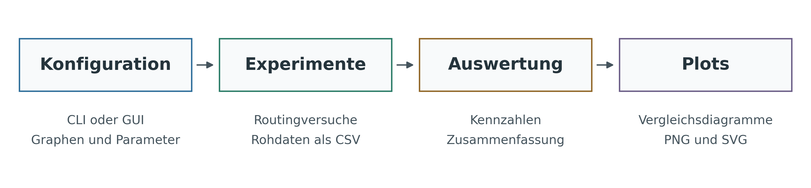

# Erweiterung und reproduzierbare Evaluierung von Fast-Failover-Routingverfahren

Dieses Repository enthält die Implementierung und die begleitenden Artefakte
der Bachelorarbeit **„Erweiterung und reproduzierbare Evaluierung von
Fast-Failover-Routingverfahren mit kanten- und knotendisjunkten Pfaden“**.

Untersucht werden Routingverfahren auf Basis von kantendisjunkten Pfaden
(Edge-Disjoint Paths, EDPs) und knotendisjunkten Pfaden (Node-Disjoint Paths,
NDPs). Neben zufälligen und geclusterten Kantenausfällen werden auch zufällige
und geclusterte Knotenausfälle betrachtet. Eine automatisierte Pipeline führt
die Versuche reproduzierbar aus, speichert die Ergebnisse und erstellt die
zugehörigen Vergleichsplots.



## Autor

Die Bachelorarbeit und die darin beschriebenen Erweiterungen wurden von
**Ammar Gamous** erstellt.

ORCID: [0009-0003-0981-2945](https://orcid.org/0009-0003-0981-2945)

## Wissenschaftlicher Ausgangspunkt

Diese Arbeit basiert auf dem Verfahren **TREE (Tree Routing to Extend Edge
Disjoint Paths)** und der dazu veröffentlichten Referenzimplementierung:

- [TREE-Repository von Oliver Schweiger](https://github.com/oliver306/TREE)
- [TREE-Paper: Improving the Resilience of Fast Failover Routing](https://arxiv.org/abs/2111.14123)

TREE erweitert kantendisjunkte Pfade zu einer oder mehreren Baumstrukturen,
um zusätzliche Ausweichwege beim Fast-Failover-Routing bereitzustellen. Die
vorliegende Arbeit reproduziert zunächst diesen Ansatz und erweitert ihn dann
um Knotenausfälle sowie NDP-basierte Varianten von Paths, One Tree und Multiple
Trees.

Eine lokale Kopie der TREE-Referenz befindet sich unter [`external/TREE/`](external/TREE/).
Der dort enthaltene Referenzcode steht unter der
[MIT-Lizenz](external/TREE/LICENSE) und behält den ursprünglichen
Copyright-Hinweis von Oliver Schweiger.

## Beitrag dieser Arbeit

Die Implementierung umfasst insbesondere:

- sechs Routingverfahren: EDP/NDP Paths, One Tree und Multiple Trees;
- zufällige und geclusterte Kanten- sowie Knotenausfälle;
- synthetische Graphen und Real-World-Topologien im GraphML-Format;
- gemeinsame Versuchsszenen für den fairen Vergleich aller Verfahren;
- Seed-gesteuerte Graph-, Endpunkt- und Ausfallauswahl;
- die Metriken Resilienz, durchschnittliche Hopanzahl und additiver Stretch;
- eine CLI und eine Streamlit-Oberfläche mit demselben Pipeline-Kern;
- CSV-Ausgaben, Manifeste sowie automatisch erzeugte PNG- und SVG-Plots;
- Resume-Unterstützung für unterbrochene Versuchsreihen;
- dokumentierte Erweiterungsstellen für weitere Algorithmen, Fehlermodelle und
  Grapharten.

Die folgenden Abbildungen zeigen die in der Arbeit verglichenen Strukturen:

- [EDPs und NDPs](schritt5_pipeline_automatisierung/Output/illustrations/figures/thesis_comparison_edp_ndp_paths.svg)
- [EDP/NDP One Tree](schritt5_pipeline_automatisierung/Output/illustrations/figures/thesis_comparison_edp_ndp_one_tree.svg)
- [EDP/NDP Multiple Trees](schritt5_pipeline_automatisierung/Output/illustrations/figures/thesis_comparison_edp_ndp_multiple_trees.svg)
- [Kanten- und Knotenausfall](schritt5_pipeline_automatisierung/Output/illustrations/figures/failure_comparison_link_node.svg)

## Empfohlener Einstieg

Die finale und eigenständig ausführbare Experimentierumgebung befindet sich in
[`schritt5_pipeline_automatisierung/`](schritt5_pipeline_automatisierung/).
Die vorherigen Schritte dokumentieren die schrittweise Entwicklung und werden
für die Ausführung der finalen Pipeline nicht benötigt.

Voraussetzungen:

- Python 3.11 oder neuer;
- eine virtuelle Python-Umgebung;
- die Pakete aus
  [`Dokumentation/requirements.txt`](schritt5_pipeline_automatisierung/Dokumentation/requirements.txt).

### Installation

Windows / PowerShell:

```powershell
py -3.11 -m venv .venv
.\.venv\Scripts\Activate.ps1
python -m pip install --upgrade pip
python -m pip install -r schritt5_pipeline_automatisierung/Dokumentation/requirements.txt
python -m pip check
```

Linux oder macOS / Bash:

```bash
python3.11 -m venv .venv
source .venv/bin/activate
python -m pip install --upgrade pip
python -m pip install -r schritt5_pipeline_automatisierung/Dokumentation/requirements.txt
python -m pip check
```

## Pilotversuch

Vor einem vollständigen Lauf sollte zunächst die Pilotkonfiguration geprüft
und ausgeführt werden:

```text
python schritt5_pipeline_automatisierung/pipeline.py --config schritt5_pipeline_automatisierung/config/pilot.json --run-name feedback_pilot --preflight
python schritt5_pipeline_automatisierung/pipeline.py --config schritt5_pipeline_automatisierung/config/pilot.json --run-name feedback_pilot
```

Die Ergebnisse liegen anschließend unter
`schritt5_pipeline_automatisierung/Output/feedback_pilot/`. Dazu gehören
Rohdaten, eine aggregierte Summary, Vergleichsplots, `used_config.json` und
`manifest.json`.

Die vollständige Konfiguration mit 1000 Wiederholungen befindet sich in
[`config/full.json`](schritt5_pipeline_automatisierung/config/full.json).

## Grafische Oberfläche

Die Streamlit-Oberfläche verwendet denselben Pipeline-Kern wie die CLI:

```text
python -m streamlit run schritt5_pipeline_automatisierung/gui.py
```

Über die Oberfläche können Graphen, Routingverfahren, Fehlermodelle,
Failure-Parameter und Metriken ausgewählt werden. Dry Run und Preflight stehen
ebenfalls in der GUI zur Verfügung.

## Tests

Die Tests prüfen unter anderem Konfiguration und Pipeline, Routingstrukturen,
Ausfallmodelle, Reproduzierbarkeit, Resume, Ergebnisdateien, GUI-Funktionen und
die erzeugten Illustrationen.

PowerShell:

```powershell
$env:MPLBACKEND = "Agg"
python -m unittest discover -s schritt5_pipeline_automatisierung/tests -p "test_*.py" -v
```

Bash:

```bash
MPLBACKEND=Agg python -m unittest discover -s schritt5_pipeline_automatisierung/tests -p "test_*.py" -v
```

Das nichtgrafische Matplotlib-Backend `Agg` ermöglicht die Plottests auch auf
Servern ohne Desktopoberfläche. Die Streamlit-Integrationstests werden nur
ausgeführt, wenn Streamlit installiert ist.

## Repository-Aufbau

| Ordner | Inhalt |
|---|---|
| `external/TREE/` | Lokale Kopie der ursprünglichen TREE-Referenzimplementierung |
| `schritt1_reproduktion/` | Reproduktion der EDP-basierten Referenzverfahren |
| `schritt2_knotenausfaelle/` | Modellierung und erste Auswertung von Knotenausfällen |
| `schritt3_knoten_disjunkte_pfade/` | Berechnung und Untersuchung knotendisjunkter Pfade |
| `schritt4_algorithmen_vergleich/` | Gemeinsamer Vergleich der sechs Routingverfahren |
| `schritt5_pipeline_automatisierung/` | Finale Pipeline, CLI, GUI, Auswertung, Tests und Dokumentation |
| `schritt6_reproduzierbarkeit/` | Unterlagen zur Prüfung der Experimentierumgebung |
| `schritt7_erweiterung/` | Erweiterungsleitfaden und Rückmeldungen der Testpersonen |
| `schritt8/` | Bachelorarbeit und Präsentationsfolien |

## Dokumentation

Die wichtigsten Einstiegspunkte sind:

- [Anleitung zur finalen Pipeline](schritt5_pipeline_automatisierung/Dokumentation/README.txt)
- [Übersicht der Projektmodule](schritt5_pipeline_automatisierung/Dokumentation/Modulübersicht.txt)
- [UML-Dokumentation](schritt5_pipeline_automatisierung/Dokumentation/UML/index.html)
- [Leitfaden für Erweiterungen](schritt7_erweiterung/ERWEITERUNG.txt)

## Wiederholbarkeit

Ein gleicher Seed allein genügt nicht für identische Ergebnisse. Für einen
Wiederholungslauf müssen auch Konfiguration, Eingabegraphen, Codeversion,
Python-Version und relevante Bibliotheksversionen übereinstimmen. Die Pipeline
speichert deshalb die tatsächlich verwendete Konfiguration sowie technische
Angaben und Prüfsummen im Laufordner.

Für unabhängige Wiederholungstests sollten neue Laufnamen verwendet werden.
Ein erneuter Aufruf mit aktiviertem Resume verwendet bereits gespeicherte
Ergebnisse und stellt daher keine unabhängige Neuberechnung dar.